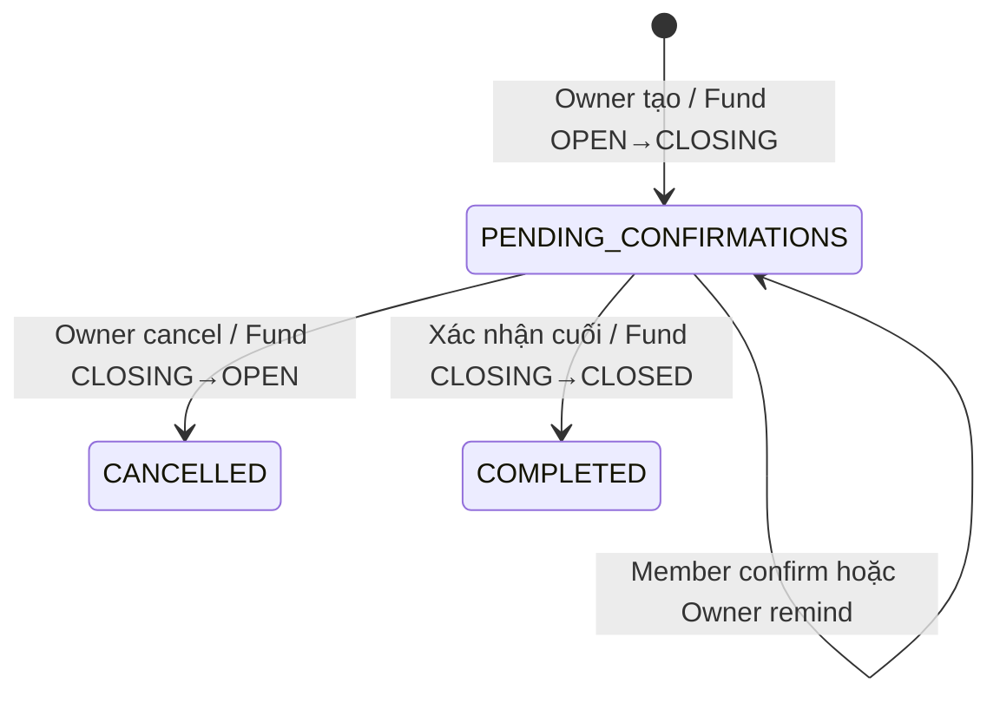

# Finance Closure API120–125

## Mục tiêu và trạng thái

Closure chốt một phiên sổ quỹ của chuyến đi. Owner chỉ được bắt đầu khi Fund đang `OPEN`,
số dư hiện tại và tổng ledger đều bằng 0, đồng thời không còn nghĩa vụ hoặc ngoại lệ tài
chính chưa xử lý. Finance tạo một snapshot bất biến; mọi thành viên active tại đúng thời
điểm đó phải xác nhận cùng một SHA-256 trước khi Fund chuyển thành `CLOSED`.

Mốc này triển khai API120–125 qua HTTP, gRPC, PostgreSQL và protocol operation bền vững
giữa Trip và Finance. Hai bảng `finance_closures` và `closure_confirmations`, cột
`trips.closure_lock_id` cùng ba event Closure đã có trong V001/catalog, nên không thêm
migration hoặc event type.

## API và quyền

| API | Route                                        | Quyền                        | Kết quả                                             |
| --- | -------------------------------------------- | ---------------------------- | --------------------------------------------------- |
| 120 | `POST /api/v1/funds/{fund_id}/closures`      | current Owner                | Tạo snapshot và chuyển Fund sang `CLOSING`          |
| 121 | `GET /api/v1/funds/{fund_id}/closures`       | current Member               | Lịch sử theo cursor `requested_at,id`               |
| 122 | `GET /api/v1/closures/{closure_id}`          | current Member               | Một closure và tiến độ xác nhận                     |
| 123 | `POST /api/v1/closures/{closure_id}/confirm` | chính user có trong snapshot | Xác nhận đúng `snapshot_hash`; người cuối đóng Fund |
| 124 | `POST /api/v1/closures/{closure_id}/cancel`  | current Owner                | Hủy phiên pending và đưa Fund về `OPEN`             |
| 125 | `POST /api/v1/closures/{closure_id}/remind`  | current Owner                | Ghi tín hiệu reminder bền vững, trả `202`           |

Mọi writer cần UUID `Idempotency-Key`. Create dùng `expected_finance_version`; confirm
bind trực tiếp vào hash; cancel cần reason không rỗng tối đa 1024 ký tự; remind chỉ nhận
object rỗng. Reader kiểm membership hiện tại qua Trip. Một user không được xác nhận thay
người khác và Owner không có quyền override nếu họ không nằm trong snapshot.

## Điều kiện tạo

Repository khóa dòng Fund và kiểm tra tất cả điều kiện trong cùng transaction:

- Trip chưa archive, actor là current Owner, Holder vẫn active, Fund `OPEN` và version khớp;
- `current_balance = 0` và tổng `IN - OUT` của ledger cũng bằng 0;
- không có contribution `PENDING` hoặc `TRANSFER_REPORTED`;
- không có expense chưa soft-delete ở `DRAFT` hoặc `SUBMITTED`;
- không có refund `PENDING`, `HOLDER_REPORTED`, hoặc refund `CONFIRMED` đã yêu cầu reversal
  nhưng chưa kết thúc;
- không có payment attempt `CREATED`, `PENDING`, `needs_reconciliation`, hoặc `SUCCEEDED`
  chưa phản ánh thành contribution xác nhận với ledger tương ứng;
- không có webhook chữ ký hợp lệ ở `RECEIVED` hoặc `NEEDS_REVIEW` gắn với payment attempt
  của Fund.

`DRAFT` phải được xóa mềm hoặc xử lý trước khi đóng. Webhook chữ ký không hợp lệ không
được dùng để giữ khóa vô thời hạn. Unique index đảm bảo mỗi Fund chỉ có một closure pending
và tối đa một closure completed.

## Snapshot và hash

Snapshot schema 1 được dựng dưới cùng Fund lock và chứa:

- projection Fund an toàn, finance version của chính snapshot và danh sách user bắt buộc;
- contribution requests, contributions, expenses còn hiệu lực, Financial Notes, refunds;
- toàn bộ ledger theo thứ tự `sequence,id`.

Các mảng và khóa được sắp ổn định trước khi serialize. SHA-256 lowercase được tính trên
canonical JSON và lưu cùng từng hàng confirmation. Snapshot không chứa payment destination,
tài khoản ngân hàng/MoMo, `destination_snapshot`, receipt object key, provider payload,
webhook payload, secret hoặc audit log. Snapshot và hash không đổi khi có confirm, remind
hoặc cancel; trạng thái và timestamp nằm ngoài snapshot.

## State machine và lock liên service

`CREATE_CLOSURE` chỉ Begin khi Trip chưa có closure lock. Finance commit Closure, confirmation
rows, Fund `CLOSING`, audit, outbox và command receipt trước; receipt mang
`set_closure_lock_id`. Trip Complete đặt đúng closure ID vào `trips.closure_lock_id`.

Confirm, cancel và remind chỉ Begin khi lock tồn tại và Finance kiểm lock ID trùng closure.
Confirm trung gian và remind giữ lock. Cancel hoặc confirm cuối ghi
`release_closure_lock_id`; Trip chỉ gỡ khi ID khớp. Nếu Complete bị mất, recovery đọc effect
từ Finance receipt và hoàn tất set/release mà không chạy lại mutation. Trong thời gian lock,
các mutation Finance khác bị chặn; membership/lifecycle cũng phải tôn trọng lock ở Trip.

Không giữ transaction database trong lúc gọi RPC. Trip lấy authorization snapshot trước,
Finance commit local, rồi Trip Complete local theo protocol hiện hành.

## Event và reminder

Create ghi `ClosureRequested`; cancel ghi `ClosureCancelled`; xác nhận cuối ghi
`FinanceClosed`. API125 ghi thêm một `ClosureRequested` với event ID mới, closure ID và hash
hiện tại rồi trả accepted. Nó không chứng minh email/push đã được gửi. Automation delivery,
channel preference, giới hạn một reminder mỗi ngày và dedupe delivery là mốc sau.

## Tính bất biến và giới hạn

- Confirm lặp bằng cùng operation là replay; confirm lại bằng operation mới là no-op và không
  tăng finance version.
- Cancel làm mất hiệu lực phiên cũ. Closure mới sau cancel có ID, snapshot, hash và confirmation
  rows riêng; không kế thừa xác nhận.
- Không tự đóng theo timeout, không reopen Fund `CLOSED`, không sửa hoặc xóa ledger cũ.
- Mốc này không kết nối ngân hàng/provider, không gửi notification thực, không tạo export
  Finance và không xử lý Price Watch.

Contract HTTP ở [finance-closures.openapi.json](../api/finance-closures.openapi.json).
Chạy riêng bằng `corepack pnpm finance:closures:test`; bài test cần Docker Engine và dựng
PostgreSQL/MinIO cô lập. `corepack pnpm finance:test` chạy cùng toàn bộ regression Finance.
